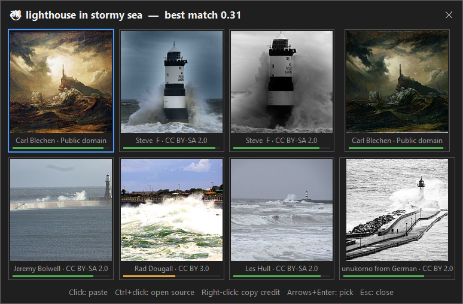

# EZsearch: slow on purpose, steady on your sentence

*This is my entry for Week 3 of the Hacktoberfest Open-Source AI Challenge, "Slow and Steady".
The repo is https://github.com/zish-s/EZsearch.*

Illustrating a sentence should not cost you the sentence. That is the whole thesis; everything else
is engineering.



*Not a mockup: the real popup, rendered by `scripts/screenshot.py` through the real pipeline.*

**Select a sentence in Word - or Google Docs, or PowerPoint, or a browser. Press `Ctrl+Shift+X`. Up
to eight pictures appear next to the cursor. Click one and it is pasted after the sentence. The
sentence is still there. You never left the document.**

## The tax this replaces

The usual loop is: new tab, search engine, scroll, right-click, copy, switch back to the document,
paste. Seven steps. My train of thought is gone by step three, and by step six I have often given up
and shipped the sentence without a picture - which is a loss, because a good picture does the
persuading for you.

The expensive part is not the searching. It is the switching: the paragraph you were holding in your
head does not survive a detour through an image search.

So I built the thing that removes the detour.

## What "slow" buys

Week 3 is about slow and steady, and EZsearch is genuinely slow in the middle - on purpose. Two open
models run on the laptop, and neither one talks to a cloud:

- **~13 s** for the first picture of a new subject, on a laptop with no GPU and no API keys.
- **~1 s** for the same subject again: pictures and CLIP vectors are cached on disk.
- **Zero** network round trips for the sentence itself. Only the 2-5 word query and the picture
  downloads leave the machine.

The measured cold pipeline, median over the benchmark sentences:

| Stage (llama3.2:3b, cold cache) | Time |
|---|---|
| The local LLM turns the sentence into a query | 3.5 s |
| Commons + Openverse search | 1.9 s |
| Download and CLIP-score the candidates | 8.1 s |
| **Sentence to picture** | **13.4 s** |

Compare that with the thirty seconds of context switching it replaces. The seconds are similar -
what changes is that you get to keep your attention. That trade is the product. Making the machine
faster was never the goal; making *you* not notice the time is.

The privacy follows from the same choice: your sentence is read from the clipboard and handed to a
local Ollama server, and it never leaves the machine. The only things that cross the network are a
short query and the pictures you end up seeing.

## One picture, end to end

1. **Capture.** The selected text is read from the clipboard. Word is allowed to ignore synthetic
   keystrokes, though, so there is a second path: read the selection over Word's own automation and
   collapse it to its end - which is why the picture is appended after your sentence instead of
   replacing it.
2. **Query.** Llama 3.2 3B, served by a local Ollama, turns the sentence into a short,
   photographable phrase.
3. **Fan out.** Wikimedia Commons (no API key at all) and Openverse (anonymous quota; a free key
   raises it) are queried in parallel. Their answers are merged, licence-filtered and de-duplicated.
4. **Trim.** Commons is an archive, not a stock library: paintings and engravings sit next to
   photographs, so artwork is dropped by its categories. Duplicate uploads collapse - the same page
   twice, the same painting re-uploaded under other names (its "*title* by *artist*" category is the
   identity key), and previews that are literally identical pixels (a 64-bit picture hash).
5. **Score softly.** CLIP ViT-B/32 (fastembed, ONNX) scores every surviving candidate against the
   whole sentence. The score drives the match bar and the "no strong match" warning - but not the
   order, and the next section explains why.
6. **Show.** Eight tiles over the scored pool, with a **+ show more** page for the rest, plus
   keyboard control for people who do not want to reach for the mouse.
7. **Paste.** The exact child control that had focus before the popup gets it back, and the picture
   is pasted there. If the synthetic keystroke is ignored, Word's automation does it instead.

## Three decisions I would defend in a review

**1. The grid is not reordered by CLIP, because I measured it.** Re-ranking was the plan: let the
vision model read the whole sentence and put the best picture first. Before shipping it, I tested it
against the search engine's own order on 20 sentences, with two different local models, ranking the
same candidate pool both ways. A hit means the title names a plausible subject *and* the file is a
photograph.

| Ranking (20 sentences, two models) | Top 1 | Top 3 |
|---|---|---|
| Search engine order (keywords only) | 29/40 (72%) | 31/40 (78%) |
| CLIP re-ranked | 24/40 (60%) | 31/40 (78%) |

CLIP ties at top three and loses at top one. It is excellent at comparing images to images; it is
not better than a keyword search at deciding what a keyword search should show. So CLIP still scores
every tile - the match bar and the warning are built on it - but it no longer orders the grid.
`EZSEARCH_RERANK=1` puts the experiment back. Cutting this feature was the best decision of the
week, and I only had the courage to make it because the benchmark was written first.

**2. Only open licences ever reach the grid, even when that hurts.** Pictures with `NC`, `ND`, fair
use or all-rights-reserved terms are filtered before display, and every result can copy a finished
credit line. The consequence is real: for a query like "roundabouts in chandigarh" the most
beautiful photos on the web are newspaper editorial shots, and they cannot be pasted into a report.
The app will never show them, and that is the feature, not the limitation - pasting a picture into
somebody's document is the wrong moment to improvise on licensing.

**3. The hardest code is at the edges, where the demo never looks.** `SetForegroundWindow` is enough
in Notepad and nowhere else: Office puts the caret in a *child* control, so the frame activates but
the keystroke lands on the wrong window and the picture evaporates. The fix is to capture the
focused child with `GetGUIThreadInfo` before the popup appears, then restore it with
`AttachThreadInput` + `SetFocus` on the child - and to detach the threads in a `finally`, or the
user loses keyboard control system-wide. The same Word behaviour bites the capture side: a
synthetic `Ctrl+C` is as ignorable as a synthetic `Ctrl+V`, so both ends have an automation path
through Word itself. That is 80% of the debugging and 0% of the demo, and no amount of model quality
makes up for the picture going nowhere.

## Field notes: four things that broke

**The hotkey was already taken.** The first build used `Ctrl+Alt+F`, which is Word's *Insert
Footnote* accelerator: Word accepted the keystroke and helpfully inserted a footnote. EZsearch now
defaults to `Ctrl+Shift+X`, configurable with `EZSEARCH_HOTKEY`.

**One painting, three file names.** The first picture the app showed me was a nineteenth-century oil
painting that kept returning under unrelated upload names. Commons names single works in categories
of the form "*title* by *artist*" - that category is both the artwork signal and a de-duplication
key, and it is how three re-uploads became one tile.

**A cached zero vector poisoned every run.** One unreadable image made the whole embedding batch
fail; the bare `except` returned zeros, and the zeros went into the on-disk vector cache. Every
later run was fast and meaningless. Zero vectors are never cached now, failed batches retry one
image at a time, and the failure is loud.

**"The roundabouts in chandigarh" returned roundabouts from everywhere but Chandigarh.** The
filename search matched one file, so the old query ladder shrank the query to "roundabout" and
showed the world. The ladder is precision-first now: the query as given and the same words without
fillers lead the grid; when filename search is thin, Commons' category space is mined instead
("Road bridges in Chandigarh" and friends); the closest broader phrasing fills the pool *behind* the
topical head, so Show more still has pages. The same live test caught Openverse being locked out for
ten minutes after one hiccup - a minute now, with a longer timeout and one retry per source.

## Slow and steady is a test suite, not a vibe

64 offline tests run with no network and no models. Every bug above has a test that fails without
the fix. The benchmark set (20 sentences x 2 models) is a fixture, so "model quality" and
"re-ranking" are numbers rather than opinions. The boring measures are what make a slow app feel
steady: same input, same grid, every time.

## Demo

<!-- Screenshots / a short GIF go here: the hotkey over a Word selection, the grid,
     and the picture landing under the sentence. -->

*placeholder 1: the hotkey over a selection in Word*

*placeholder 2: the popup grid with match bars*

*placeholder 3: the picture pasted below the sentence, sentence intact*

## What the community already knew

I did not invent the Win32 recipe. The `AttachThreadInput` sandwich is written up in
[After 4 months solo: shipping a Windows tray AI hotkey on .NET 8 + WPF (and the Win32 paste-back
rabbit hole)](https://dev.to/phantasmat2018/after-4-months-solo-shipping-a-windows-tray-ai-hotkey-on-net-8-wpf-and-the-win32-paste-back-50hm)
by [phantasmat2018](https://dev.to/phantasmat2018) - it is the post that saved me from the
"works in Notepad and nowhere else" phase, down to the detail that the detach belongs in a
`finally`.

On the AI side, [Local Embeddings with Fastembed, Rig &
Rust](https://dev.to/joshmo_dev/local-embeddings-with-fastembed-rig-rust-3581) by
[joshmo_dev](https://dev.to/joshmo_dev) made ONNX embeddings feel like something a laptop can do,
and [Build an offline visual defect search system with CLIP and VectorAI
DB](https://dev.to/actiandev/build-an-offline-visual-defect-search-system-with-clip-and-vectorai-db-4pll)
by [actiandev](https://dev.to/actiandev) is a good picture of what CLIP is actually for -
comparing images to each other, where it is excellent, rather than re-scoring a keyword search,
where this benchmark says it is not.

## What I would build next

**Local-folder mode.** Point the same scorer and the same popup at your own photo folders: fully
offline, no network at all, and the pictures are already yours, so there is no licensing question to
answer. The candidate source changes; nothing else has to.

## Try it

```bash
git clone https://github.com/zish-s/EZsearch.git
cd EZsearch
python -m venv .venv && source .venv/bin/activate    # Windows: .venv\Scripts\activate
pip install -r requirements.txt
ollama pull llama3.2:3b
python ezsearch.py
```

First run downloads the CLIP weights (~600 MB, cached afterwards). After that it starts instantly
and ranks entirely offline.

```bash
python -m pytest        # 64 offline tests
python ezsearch.py --doctor
python ezsearch.py --search "a sentence"   # headless
```

Windows is the tested platform; macOS and Linux have focus and clipboard paths, but the paste-back
was verified against a native Windows child control.

MIT licence. The code is mine, the models keep their licences, and the pictures keep theirs - which
is why every single one of them tells you where it came from.
